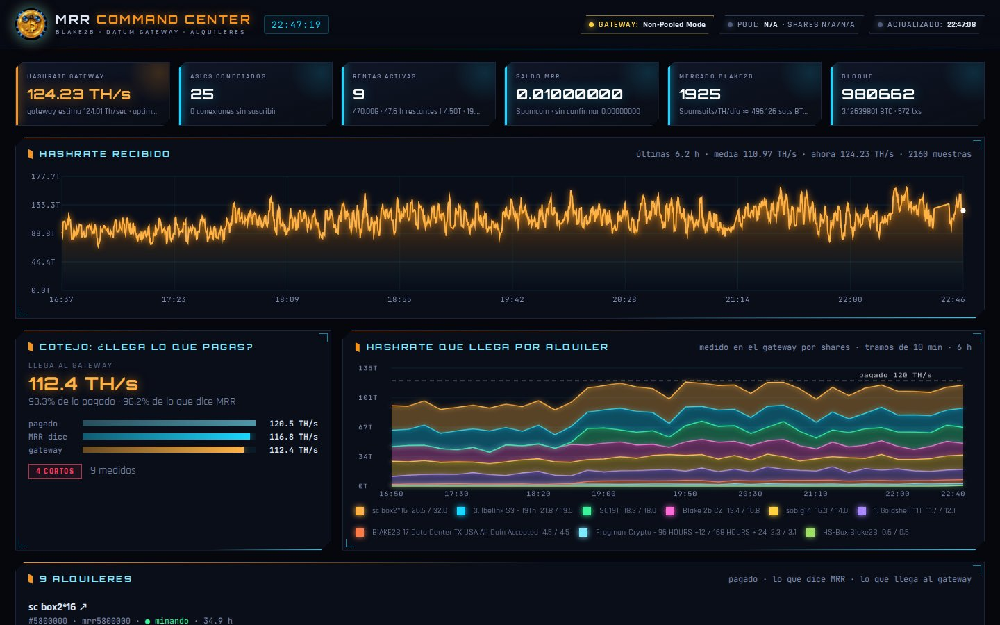
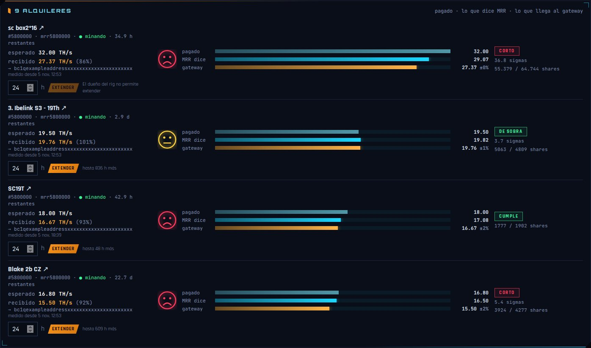
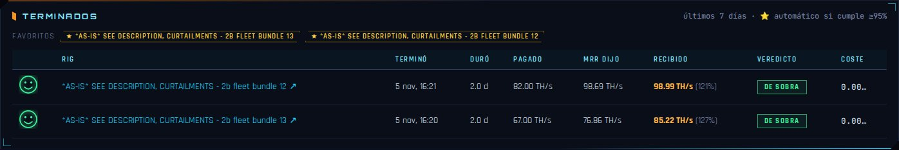
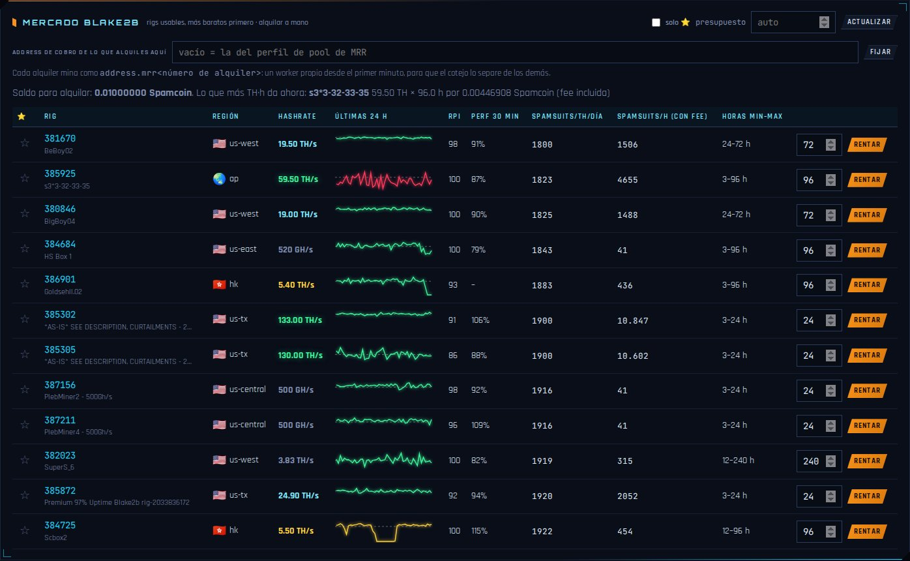

<p align="center"></p>

# MRR Command Center

**Does the hashrate you rent actually reach your gateway?** A local web dashboard for
renting Blake2B hashrate on [MiningRigRentals](https://www.miningrigrentals.com) (MRR)
into your own [DATUM](https://github.com/OCEAN-xyz/datum_gateway) gateway, and checking
every rental against what the gateway really receives.

> Fork of [MarcanoFilms/mrr-blake2b-bot](https://github.com/MarcanoFilms/mrr-blake2b-bot)
> by [Marcano Trades](https://github.com/MarcanoFilms): the MRR client, the gateway view and
> the look of the MRR Command Center are his work. This fork turns it into a rental
> auditor with manual renting. His automatic rental bot is still in the code, switched
> off; see [Upstream bot](#upstream-bot-optional).



- **Every rental judged**: what you paid for, what MRR says it delivered and what your
  gateway accepted, with a statistical verdict and a face that tells you at a glance.
- **One worker per rental**, so rentals that all arrive through MRR's proxies can be told
  apart, mining to a payout address you fix.
- **Manual renting** from the market, with each rig's last 24 h of hashrate, its region,
  prices per TH and day and per hour, and a confirmation before anything is spent.
- **History and favourites**: finished rentals are kept for 7 days with their final
  verdict, and rigs that delivered are starred automatically.
- **Gateway**: every ASIC connected to your DATUM gateway (address, worker, hashrate,
  shares, kick button) and the gateway's log.

No dependencies beyond Python 3.10+ and the standard library. Screenshots below have
addresses, IPs, rental numbers and balances masked.

| Rentals | History |
|---|---|
|  |  |



<p align="center"></p>

## How it works

### Rental audit

MRR shows how much hashrate *it* measured for each rental. The audit checks that
against what your own gateway accepted, so you can tell a weak rig, a lossy path or
a wrong number apart. For every active rental the dashboard shows three figures:

| | source |
|---|---|
| **paid** | the rental's advertised TH/s |
| **MRR says** | MRR's own average for the rental |
| **gateway** | accepted shares × share difficulty for the rental's worker, from the gateway's client page |

Cards: **Cotejo** (totals), **Hashrate que llega por alquiler** (stacked chart per
rental, complete 10-minute buckets, with the paid total as a dashed line) and
**N alquileres** (expected vs received, the address it mines to, the three bars, a face
and the verdict, a link to the rental on MRR and its extend control).

The face is happy when the gateway receives more than both what was paid and what MRR
reports, straight within 5 % of what was paid and sad below that. The verdict next to it
is the statistical one.

How it measures (details in the docstring of `audit.py`):

- Every gateway poll is stored in `audit.db` (SQLite, `retention_days`, default 7).
- Each stratum connection has its own cumulative share counter and MRR's proxies
  reconnect often, so the work of a rental is the sum of the per-connection
  increments. A connection born inside the window counts from zero.
- Work is counted as **shares × vardiff**, not from the cumulative difficulty column:
  recent gateways print that column with an SI prefix and three significant digits
  (`2.10E`), and on a long-lived connection it does not move for hours.
- **Verdict**: the expected number of shares for the *paid* hashrate over the window
  is `TH/s × 1e12 × seconds / (vardiff × 2^32)`. A rental is `corto` (short) only when
  the shares received are more than `sigma` (default 3) standard deviations below that,
  `de sobra` (over) when above, `cumple` (ok) otherwise. Testing against the error of
  what was *measured* instead would call a rental that delivered 0.03 % "ok" (one share
  has 100 % error).
- Until 10 shares are expected the verdict is `arrancando` (starting).

**One worker per rental.** The gateway can only tell rentals apart by the stratum
worker (the part of the user after the first dot): all rentals arrive through MRR's
proxies, from a few IPs, and one rental can show several user agents. If your pool
profile gives every rental the same worker, those rentals are shown as
`worker compartido` and not judged. With `audit.assign_workers: true` the dashboard
fixes that itself: every active rental whose worker is shared (or missing) gets its
pool user rewritten through the MRR API to `<address>.<worker_prefix><rental id>`
(`PUT /rental/<id>/pool/<priority>`). That changes the pool of a rental you already
paid for; it never rents or extends. Rigs reconnect within a minute. Work from before
the change cannot be split, so the rental is judged from that moment on.

Known limit: a connection that opens and closes between two polls (10 s) is not
counted, so the gateway figure can read slightly low for rigs that reconnect very often.

### Read-only mode

`"read_only": true` hides the rent and extend controls and makes the server refuse
`/api/rent`, `/api/rent-address` and `/api/extend` (quotes still work). Useful when the
MRR key has rent permission but you only want to watch, or the dashboard is shared.

### Manual renting

Nothing rents on its own: the market table has a **Rent** button per rig and every
rental waits for a confirmation that shows its cost, length, address and worker.

A rental made from the dashboard gets a worker of its own straight away: right after MRR
creates it, its pool user is rewritten to `<rent_address>.<worker_prefix><rental id>`.
`rent_address` is set from the market card (empty = the address of the pool profile), so
the payout address stays fixed while the worker changes with every rental. The audit
then measures it from its first share, and each rental card shows the address it mines
to, the hashrate expected and the hashrate received. Extend controls live in the rental
cards; the separate "active rentals" card is shown only when the audit is off.

Market prices are shown per TH per day in hundred-millionths of MRR's currency. Its names
are configurable (`coin_label`, `unit_label`), and `alt_price` can add the same price in a
second unit: a JSON URL and the path of the value saying how much of that unit one MRR coin
buys (`invert` for the reverse). Each market rig shows a sparkline of its last 24 h of
hashrate from MRR (`/rig/<id>/graph`, cached 10 min) against what it advertises, and its
region with a flag. Extend is greyed out when the rig's owner does not allow extensions or
the rental is already at the rig's maximum length; pressing it shows MRR's price for the
extension and waits for a confirmation.

### History and favourites

When a rental stops being active, the audit judges it over its whole length (as far as
`retention_days` of samples go), reads its final price from MRR and keeps the result for
`history_days` (7): rig, end, length, paid / MRR / received TH/s, verdict and cost. A
rental that ends with an `ok` or `over` verdict at `favorite_pct` (95 %) or more of what
was paid stars its rig. Stars can also be set by hand in the market, which can be
filtered to show only them.

### Smaller changes

- `datum_service_scope`: `"system"` shows the journal of a system unit
  (`journalctl -u`) instead of a user unit.
- IPv4-mapped client addresses (`::ffff:1.2.3.4`) are shown and reverse-resolved as IPv4.
- Clients whose worker is `<worker_prefix><digits>` are labelled `MRR proxy` even when
  the proxy has no reverse DNS.

## Install

```bash
git clone https://github.com/Kilombino/mrr-command-center ~/mrr-command-center
cd ~/mrr-command-center
./install.sh                   # config.json from the example, dashboard unit + launcher
nano config.json               # api_key, api_secret, profile_id, gateway password, own_addresses
python3 -I mrr_bot.py status   # checks the API key and balance
python3 -I mrr_bot.py pools    # checks the pool profile points at your gateway
systemctl --user enable --now mrr-dashboard.service
```

The dashboard listens on `dashboard_port` (7160) behind a password (a random one is
written to `config.json` on first start). On MRR you need an API key with *rentals* and
*balance* permissions (and *rent* to rent or extend from the dashboard), and a **pool
profile** (Account → Pools) whose pool is your gateway's public stratum address.
`profile_id` is the number of that profile.

If the gateway runs behind a VPN with port forwarding (the usual setup for a home node),
the stratum port MRR connects to is the forwarded one, not the local one.

`launcher/mrr-command-center.sh` opens the dashboard as a standalone window (Chromium app
mode); `install.sh` adds a desktop entry for it.

## Config reference

Keys marked *market* decide which rigs the market card lists (and the upstream bot rents); keys marked *bot* only matter for the upstream bot.

| key | default | meaning |
|---|---|---|
| `api_key`, `api_secret` | | MRR API credentials |
| `algo` | `blake2b` | MRR algo name |
| `currency` | `BTC` | balance / price currency |
| `profile_id` | | MRR pool profile that points at your gateway |
| `reserve_btc` | 0 | never spend below this confirmed balance (*bot*) |
| `max_spend_per_run_btc` | 0.002 | hard cap per pass (the timer interval is the cap window) (*bot*) |
| `max_concurrent_rentals` | 1 | rigs rented at the same time (*bot*) |
| `max_hours` / `min_hours` | 240 / 3 | rental length bounds (*market*) |
| `min_rpi` | 85 | rig performance index floor (0-100) (*market*) |
| `allow_new_rigs` | false | accept rigs with no rental history (*market*) |
| `min_perf_ratio` | 0.75 | last-30-min / advertised hashrate floor (*market*) |
| `max_price_premium` | 1.25 | ignore rigs above market `last_10` × this (*market*) |
| `price_tolerance` | 0.05 | ties within this fraction go to the longest rental (*bot*) |
| `fee_rate` | 0.03 | MRR renter fee added on top of the rig price |
| `extend_window_hours` | 2 | extend rentals ending within this window (*bot*) |
| `excluded_regions`, `excluded_rigs` | `[]` | blacklist by region code / rig id (*market*) |
| `telegram.token`, `telegram.chat_id` | | Telegram bot token + chat for rent/extend notifications |
| `dashboard_port` | 7160 | dashboard listen port (binds all interfaces) |
| `dashboard_password` | random | dashboard login |
| `own_addresses` | `[]` | your payout addresses, to tell your miners from foreign ones |
| `gateway.url/user/password` | `http://127.0.0.1:7158`, `oracle` | DATUM gateway admin page + digest auth |
| `datum_service` | `datum-convoy.service` | systemd unit whose journal the dashboard shows |
| `datum_service_scope` | `user` | `user` or `system` |
| `read_only` | false | the dashboard never rents nor extends |
| `bot_ui` | false | true: show the upstream bot’s controls, history and log |
| `rent_address` | `""` | payout address for rentals made from the dashboard, `""` = profile's |
| `coin_label` / `unit_label` | `BTC` / `sats` | names shown for MRR's currency and its 1e-8 unit |
| `alt_price` | `{}` | optional second price unit: `label`, `url`, `path`, `invert` |
| `audit.enabled` | true | record gateway samples and show the rental audit |
| `audit.assign_workers` | false | give each active rental its own worker through the MRR API |
| `audit.worker_prefix` | `mrr` | worker name = prefix + rental id |
| `audit.sigma` | 3 | standard deviations before calling a rental short |
| `audit.retention_days` | 7 | how long gateway samples are kept in `audit.db` |
| `audit.series_hours` / `audit.series_bucket_s` | 6 / 600 | per-rental chart span and bucket |
| `audit.history_days` | 7 | how long finished rentals stay in the history |
| `audit.favorite_pct` | 95 | % of the paid hashrate a finished rental needs to star its rig |

## Upstream bot (optional)

Marcano's original rental bot is still here (`mrr_bot.py`): every 15 minutes it extends
rentals about to end and rents the rig that buys the most TH·hours with the budget. It is
off in this fork. To use it, set `"bot_ui": true` (controls, history and log in the
dashboard), run `./install.sh --with-bot` and read
[the upstream README](https://github.com/MarcanoFilms/mrr-blake2b-bot#how-it-decides) for
how it decides.

## Files

```
dashboard.py      MRR Command Center server
audit.py          rental audit: gateway samples, verdicts, per-rental worker, history, favourites
mrr_bot.py        MRR API client (and the upstream bot, off by default)
www/index.html    dashboard UI (single file, no build step)
www/img/          logo, favicon and login cover
docs/img/         screenshots for this README (personal data masked)
systemd/          mrr-dashboard.service (+ the upstream bot's units)
launcher/         Chromium app-mode launcher + .desktop template
config.json       your secrets and knobs (gitignored)
state.json        API nonce + action log (gitignored)
history.json      gateway hashrate history (gitignored)
audit.db          gateway samples, rental history, favourites (gitignored)
```

## Notes and gotchas

- MRR API nonces must be strictly increasing per key. API calls are serialised with a
  file lock (`.mrr.lock`) and the last nonce lives in `state.json`. Do not run two
  programs against the same key with different state files.
- MRR applies a renter fee on top of the rig price (3 % at the time of writing,
  `fee_rate`); the dashboard includes it in costs and hourly prices.
- The dashboard UI text is in Spanish for now. Pull requests translating it are welcome.
- Run the scripts with `python3 -I` (as the units do) so nothing in the working
  directory can shadow standard modules.

## License

MIT. Original bot, MRR client and dashboard by [Marcano Trades](https://github.com/MarcanoFilms).
Rental audit, manual renting, history and the other changes in this fork by
[Kilombino](https://github.com/Kilombino), same license.
